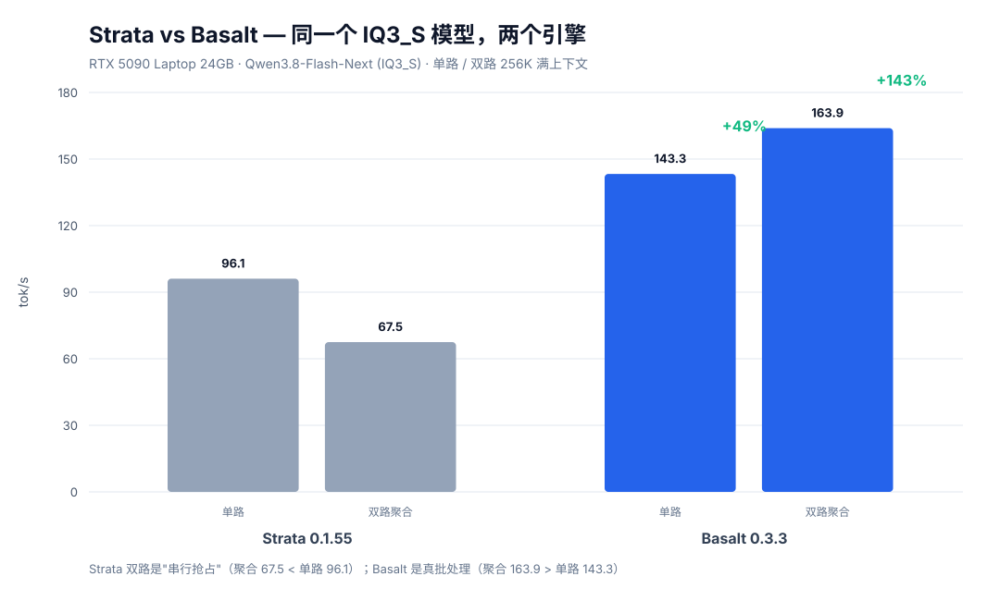
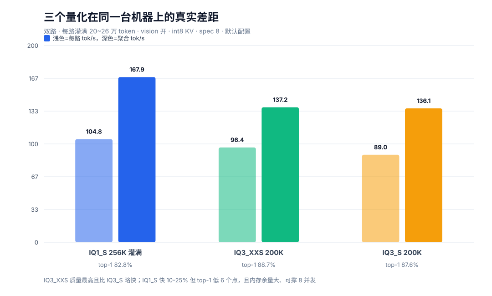
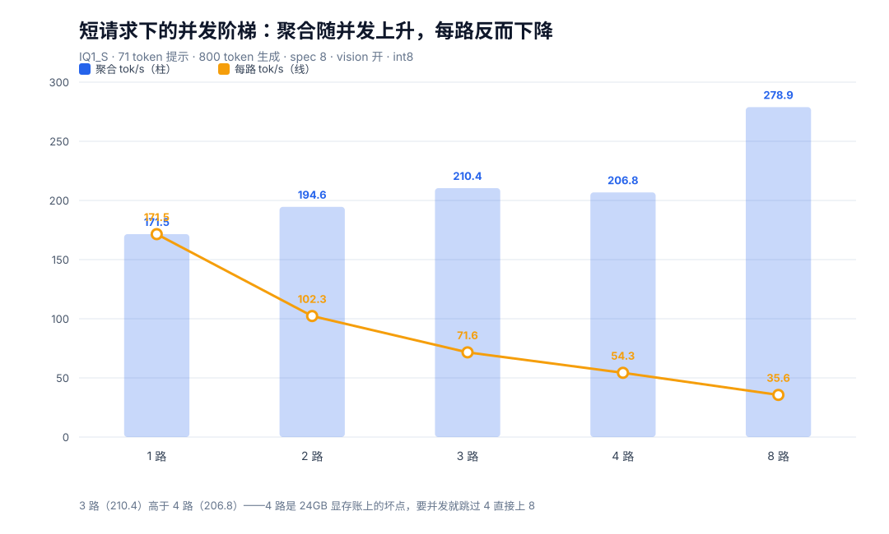
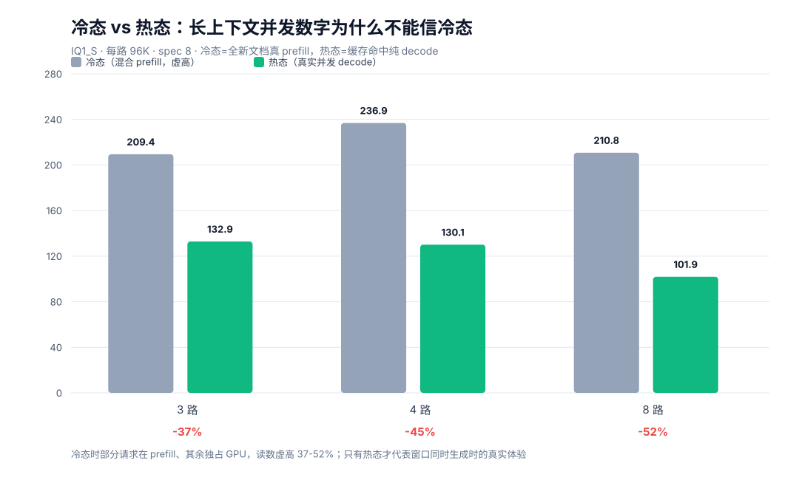
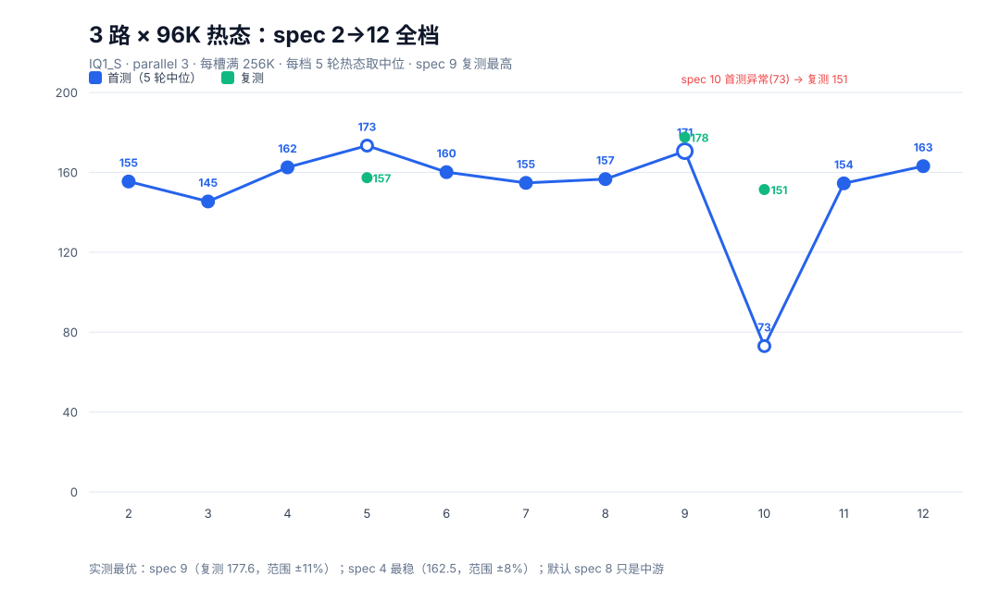
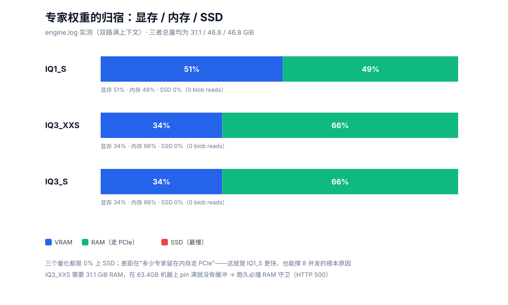

# Qwen3.8-Flash-Next · RTX 5090 Laptop 24GB · Strata vs Basalt

> Same 24GB laptop, same 177B MoE, only the engine changed:
> single-lane **96.1 → 143.3 tok/s (+49%)**, dual-lane aggregate **67.5 → 163.9 tok/s (+143%)**,
> and "3 lanes × 96K context at once" went from crashing to usable.
>
> Every number below is measured on this machine (reproduce commands at the end).

---

## TL;DR — what to run

| Use case | Engine / model / lanes | Measured |
|---|---|---|
| Two windows, daily chat | Basalt · UD-IQ1_S · dual 256K · spec 2 | **~110 tok/s per lane** (short), 114-144 at full context |
| Three windows, long docs | Basalt · UD-IQ1_S · 3 lanes · spec 9 | ~50 tok/s per lane, Σ 178 (96K hot) |
| Batch short requests | Basalt · UD-IQ1_S · 8 lanes · spec 8 | Σ **279 tok/s** |
| Quality first (top-1 88.7%) | Basalt · UD-IQ3_XXS · single/short context | 96 per lane (200K dual), watch RAM headroom |
| Retired | Strata 0.1.55 (Windows) | dual 67.5, serialized |



---

## Hardware

RTX 5090 Laptop **24 GB** (WDDM) · 63.4 GB DDR5 · NVMe · no AVX-512 (engine runs AVX-2 kernels) · Windows 11 native (no WSL2).
Basalt 0.3.3 x64 native vs Strata 0.1.44→0.1.55. Official `.basalt` packs: Unsloth UD-IQ1_S / UD-IQ3_XXS, ISTA-DASLab IQ3_S.

Expert weights are tiered: what fits in VRAM stays, the rest lives in **page-locked RAM**; only the n-gram table is read from SSD.
On this machine **0% of experts sit on SSD** for all three quants.

---

## 1. Strata era: the dual-lane paradox

| Version | Single | Dual aggregate |
|---|---:|---:|
| 0.1.44.1 | 97.7 | forced 2×128K |
| 0.1.50 | 93.1 | 67.0 |
| 0.1.52 | 96.1 | — |
| **0.1.55** | 96.1 | **67.5** |

Batch2 compressed the expert cache to 2161 slots / 4.15 GB, so the two requests took turns instead of decoding together:
each ran near full speed (66.6) but their time did not overlap, capping aggregate at 67.

---

## 2. Basalt: 143 single, 164 dual

| | Strata 0.1.55 | **Basalt 0.3.3** | Δ |
|---|---:|---:|---:|
| Single lane | 96.1 | **143.3** | **+49%** |
| Dual aggregate | 67.5 | **163.9** | **+143%** |
| Dual > single? | No (67.5 < 96.1) | **Yes (163.9 > 143.3)** | real batching |
| 130K prefill | ~2700 tok/s | **3716 tok/s** | +38% |

Basalt swaps hot experts between VRAM and pinned RAM (`0 blob reads from the file`), so dual-lane is genuine batch decoding.

---

## 3. Three quants, one machine



| Model | File | Experts | Per lane | Aggregate | Accept | top-1 | Note |
|---|---:|---:|---:|---:|---:|---:|---|
| **UD-IQ1_S** | 65.6 GiB | 31.1 GiB | **104.8** | **167.9** | 72.4% | 82.76% | fastest, RAM headroom, 8 lanes OK |
| **UD-IQ3_XXS** | 81.6 GiB | 46.8 GiB | 96.4 | 137.2 | 59.8% | **88.67%** | best quality, RAM tight |
| IQ3_S | 81.6 GiB | 46.8 GiB | 89.0 | 136.1 | 57.1% | 87.56% | superseded by IQ3_XXS |

`UD-IQ3_XXS` replaces `IQ3_S` outright (same expert footprint, higher quality, slightly faster). `UD-IQ1_S` is the speed tier: 10-25% faster, 6 points lower top-1.

---

## 4. Concurrency: short prompts and long contexts move in opposite directions

### Short prompts (71-token prompt, 800-token output)



| Lanes | 1 | 2 | 3 | 4 | 8 |
|---|---:|---:|---:|---:|---:|
| Per lane | **171.5** | 102.3 | 71.6 | 54.3 | 35.6 |
| Aggregate | 171.5 | 194.6 | 210.4 | 206.8 | **278.9** |

3 lanes beat 4 (210.4 vs 206.8): 4 lanes is the VRAM bad point — skip it.

### Long context (96K per lane, hot)

| Lanes | Per lane | Aggregate |
|---:|---:|---:|
| **3** | **42.0** | **132.9** |
| 4 | 31.5 | 130.1 |
| 8 | 11.8 | 101.9 |

Opposite of short prompts: 8 lanes is the **worst** at 96K (KV 15.2 GiB pushes every expert out of VRAM), 3 lanes is the sweet spot.

### Capacity (does it even run)

| Setup | Result |
|---|---|
| Dual × 258,772 tokens | stable |
| **8 lanes × 254,699 tokens** | 8/8 OK, one shot |
| 4 lanes × 240K | OK (prefill 77-360 s) |
| 3 lanes × 260K / 200K / 128K | engine aborts silently |

---

## 5. Cold vs hot: why earlier long-context numbers were inflated



| Lanes | Cold Σ | Hot Σ | Inflation |
|---|---:|---:|---:|
| 3 | 209.4 | **132.9** | −37% |
| 4 | 236.9 | **130.1** | −45% |
| 8 | 210.8 | **101.9** | −52% |

In a cold wave some requests are still prefilling (near-zero decode cost), so the rest own the GPU and report 100+ tok/s. It is not reproducible
(8 lanes cold: 164.7 vs 256.9, 56% apart). Hot waves (all lanes decoding, cache hit) vary only ±5-10%. **Long-context concurrency must be measured hot.**

---

## 6. spec sweep at 3 lanes × 96K



| spec | 2 | 3 | 4 | 5 | 6 | 7 | 8 (default) | **9** | 10 | 11 | 12 |
|---|---:|---:|---:|---:|---:|---:|---:|---:|---:|---:|---:|
| Σ tok/s | 155.4 | 145.4 | 162.5 | 173.4→157.3 | 160.1 | 154.7 | 156.6 | **170.6→177.6** | 73.0→151.4 | 154.5 | 163.1 |
| Accept | 67.7% | **74.6%** | 72.8% | 65.0% | 63.1% | 60.6% | 63.9% | 66.3→73.1% | 62.9% | 65.7% | 63.0% |

- Best: `--spec 9` (170.6 / 177.6 across two runs, ±11%)
- Steadiest: `--spec 4` (162.5, ±8%)
- Highest acceptance: `--spec 3` (74.6%, but only 45 per lane)
- `spec 10` first run (73.0) was an environment failure — its cold Σ was 87.7 vs the normal 200-270; retest gave 151.4

---

## 7. Where experts live



| Model | Experts | VRAM | RAM (PCIe) | SSD |
|---|---:|---:|---:|---:|
| IQ1_S | 31.1 GiB | 15.9 (51%) | 15.2 (49%) | **0** |
| IQ3_XXS | 46.8 GiB | 15.8 (34%) | 31.1 (66%) | **0** |
| IQ3_S | 46.8 GiB | 16.0 (34%) | 30.8 (66%) | **0** |

Nothing is on SSD; the difference is how many experts take the PCIe path per token. This also explains IQ3_XXS's HTTP 500s:
it needs 31.1 GiB pinned RAM, leaving no headroom on a 63.4 GB machine, so the RAM guard stops requests:

```
error: engine reported RAM low (1948 MiB free < 2048 MiB guard):
request stopped; other programs took 1543 MiB since the engine was ready
```

Lowering the guard makes it worse: `--ram-reserve-mib 512` lets auto pin 47.1 GB and OOMs on load; `resident-budget 30` pushes 544 experts to SSD and 96K prefill stalls for 6 minutes.

---

## 8. KV precision and vision

| Format | dKLD [95% CI] | top-1 | Verdict | Usable here |
|---|---|---:|---|---|
| **int8** | **+0.0000** [−0.0010, +0.0010] | **+0.15** | **lossless** | only format allowed with `parallel` > 1; fastest single lane (171.5) |
| k8v4 | +0.0056 [+0.0038, +0.0073] | −0.20 | measurable | rejected in batch |
| q4_0 | +0.0093 [+0.0074, +0.0112] | −0.38 | measurable | rejected in batch; single lane 154.7 (10% slower than int8) |

`q4_0`/`k8v4` fail at ≥2 lanes: `batch windows need INT8 K/V without rotation`. int8 is a free halving of KV memory.

Vision ships inside the `.basalt` file (`"vision": "dynamic"` in the model entry): 0 VRAM idle, borrows expert-cache slots per image.
Measured: 48 KB JPEG → **2.1 s** end to end, 847 prompt tokens, prefill 5381 tok/s. Video needs FFmpeg DLLs (off by default).

---

## 9. Configs and launcher

| Use | Config | Command |
|---|---|---|
| Daily dual window | `basalt_config_iq1s_dual_vis.v2.json` | `serve --config ... --spec 2` |
| Three windows, long docs | `cfg_iq1s_p3_96k.v2.json` | `serve --config ... --spec 9` |
| Eight-lane batch | `cfg_iq1s_cap8.v2.json` | `serve --config ... --spec 8` |

---

## 10. Measurement lessons (ordered by cost)

1. Cold waves inflate long-context concurrency by 37-52% and are not reproducible — measure hot.
2. One run is not a measurement: the same config varied ±27% between rounds. Use ≥5 rounds and report the range.
3. Check cold Σ first: if it is only 30-40% of normal, the start was polluted (VRAM residue) and the round is void.
4. "Highest acceptance" ≠ throughput: small spec values win acceptance but lose 5-10% aggregate.
5. `timings.prompt_ms` is unreliable for 8-lane long prompts (reported 2.2M tok/s once); use end-to-end wall time.
6. `taskkill /F` denies the engine a clean exit, so `expert-profile-save` may never write; give it a ≥1 min save period.
7. GitHub contents PUT breaks after a repo rename (307); use `repositories/{id}/contents/...`.
8. `netstat` output on Chinese Windows is GBK; decode bytes as `gbk`, not UTF-8.

---

## Reproduce

```powershell
cd D:\Strata\basalt-win\basalt-v0.3.3-windows-x64
# daily dual window
.\bin\basalt.exe serve --config basalt_config_iq1s_dual_vis.v2.json `
  --python "D:\Strata\app\.venv\Scripts\python.exe" --api-key <KEY> --spec 2
# three windows, long docs (recommended for long context)
.\bin\basalt.exe serve --config cfg_iq1s_p3_96k.v2.json `
  --python "D:\Strata\app\.venv\Scripts\python.exe" --api-key <KEY> --spec 9
```

```json
{ "version": 2,
  "engine": { "expert-cache": "auto", "prefill": "auto", "resident-experts": true },
  "models": [{ "model": "…/Qwen3.8-FN-UD-IQ1_S.basalt", "kv": "int8",
               "max-context": 262144, "parallel": 3, "slot-full-context": true,
               "vision": "dynamic" }],
  "server": { "host": "0.0.0.0", "port": 8080 } }
```

---

## Credits

Model: Qwen3.8-Flash-Next (Alibaba) · GGUF quants by Unsloth (UD) and ISTA-DASLab (IQ3_S).
Engines: [Basalt](https://github.com/jesdga95/basalt) 0.3.3 · [Strata](https://github.com/Niko1221/Strata) 0.1.44→0.1.55.
All local numbers are measured; official quality figures (KV dKLD, top-1/KLD) are quoted from Basalt and Unsloth docs.
Not measured: Windows quality gate (upstream does not run it); the 3-lane long-context abort was not root-caused.
